```{=html}
<div class="irbi-prov-grid"><a class="irbi-prov-kartu" data-kode="11" href="11-aceh.html"><span class="irbi-prov-nama">Aceh</span><span class="irbi-prov-nilai">192,75</span><span class="kelas kelas-tinggi">Tinggi</span></a><a class="irbi-prov-kartu" data-kode="12" href="12-sumatera-utara.html">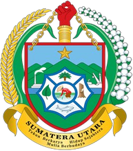<span class="irbi-prov-nama">Sumatera Utara</span><span class="irbi-prov-nilai">162,25</span><span class="kelas kelas-sedang">Sedang</span></a><a class="irbi-prov-kartu" data-kode="13" href="13-sumatera-barat.html">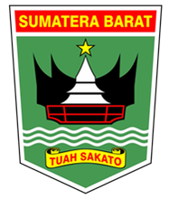<span class="irbi-prov-nama">Sumatera Barat</span><span class="irbi-prov-nilai">176,82</span><span class="kelas kelas-tinggi">Tinggi</span></a><a class="irbi-prov-kartu" data-kode="14" href="14-riau.html">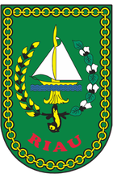<span class="irbi-prov-nama">Riau</span><span class="irbi-prov-nilai">118,15</span><span class="kelas kelas-sedang">Sedang</span></a><a class="irbi-prov-kartu" data-kode="15" href="15-jambi.html">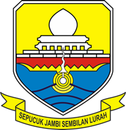<span class="irbi-prov-nama">Jambi</span><span class="irbi-prov-nilai">132,45</span><span class="kelas kelas-sedang">Sedang</span></a><a class="irbi-prov-kartu" data-kode="16" href="16-sumatera-selatan.html">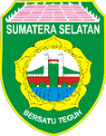<span class="irbi-prov-nama">Sumatera Selatan</span><span class="irbi-prov-nilai">139,67</span><span class="kelas kelas-sedang">Sedang</span></a><a class="irbi-prov-kartu" data-kode="17" href="17-bengkulu.html">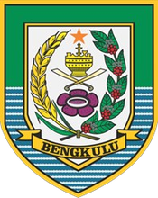<span class="irbi-prov-nama">Bengkulu</span><span class="irbi-prov-nilai">183,60</span><span class="kelas kelas-tinggi">Tinggi</span></a><a class="irbi-prov-kartu" data-kode="18" href="18-lampung.html">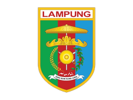<span class="irbi-prov-nama">Lampung</span><span class="irbi-prov-nilai">124,59</span><span class="kelas kelas-sedang">Sedang</span></a><a class="irbi-prov-kartu" data-kode="19" href="19-kepulauan-bangka-belitung.html">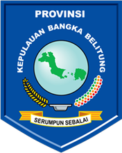<span class="irbi-prov-nama">Kepulauan Bangka Belitung</span><span class="irbi-prov-nilai">113,13</span><span class="kelas kelas-sedang">Sedang</span></a><a class="irbi-prov-kartu" data-kode="21" href="21-kepulauan-riau.html">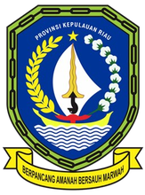<span class="irbi-prov-nama">Kepulauan Riau</span><span class="irbi-prov-nilai">132,68</span><span class="kelas kelas-sedang">Sedang</span></a><a class="irbi-prov-kartu" data-kode="31" href="31-dki-jakarta.html">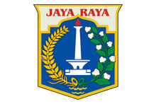<span class="irbi-prov-nama">DKI Jakarta</span><span class="irbi-prov-nilai">57,59</span><span class="kelas kelas-sedang">Sedang</span></a><a class="irbi-prov-kartu" data-kode="32" href="32-jawa-barat.html">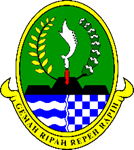<span class="irbi-prov-nama">Jawa Barat</span><span class="irbi-prov-nilai">106,02</span><span class="kelas kelas-sedang">Sedang</span></a><a class="irbi-prov-kartu" data-kode="33" href="33-jawa-tengah.html">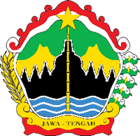<span class="irbi-prov-nama">Jawa Tengah</span><span class="irbi-prov-nilai">92,37</span><span class="kelas kelas-sedang">Sedang</span></a><a class="irbi-prov-kartu" data-kode="34" href="34-daerah-istimewa-yogyakarta.html"><span class="irbi-prov-nama">Daerah Istimewa Yogyakarta</span><span class="irbi-prov-nilai">88,91</span><span class="kelas kelas-sedang">Sedang</span></a><a class="irbi-prov-kartu" data-kode="35" href="35-jawa-timur.html">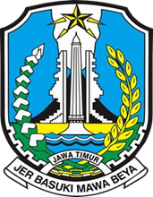<span class="irbi-prov-nama">Jawa Timur</span><span class="irbi-prov-nilai">108,36</span><span class="kelas kelas-sedang">Sedang</span></a><a class="irbi-prov-kartu" data-kode="36" href="36-banten.html">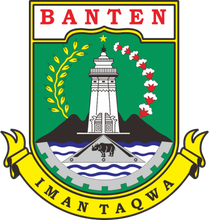<span class="irbi-prov-nama">Banten</span><span class="irbi-prov-nilai">103,58</span><span class="kelas kelas-sedang">Sedang</span></a><a class="irbi-prov-kartu" data-kode="51" href="51-bali.html">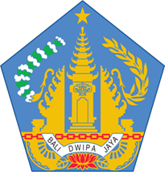<span class="irbi-prov-nama">Bali</span><span class="irbi-prov-nilai">123,35</span><span class="kelas kelas-sedang">Sedang</span></a><a class="irbi-prov-kartu" data-kode="52" href="52-nusa-tenggara-barat.html">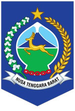<span class="irbi-prov-nama">Nusa Tenggara Barat</span><span class="irbi-prov-nilai">156,02</span><span class="kelas kelas-sedang">Sedang</span></a><a class="irbi-prov-kartu" data-kode="53" href="53-nusa-tenggara-timur.html">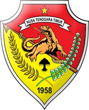<span class="irbi-prov-nama">Nusa Tenggara Timur</span><span class="irbi-prov-nilai">197,43</span><span class="kelas kelas-tinggi">Tinggi</span></a><a class="irbi-prov-kartu" data-kode="61" href="61-kalimantan-barat.html"><span class="irbi-prov-nama">Kalimantan Barat</span><span class="irbi-prov-nilai">113,32</span><span class="kelas kelas-sedang">Sedang</span></a><a class="irbi-prov-kartu" data-kode="62" href="62-kalimantan-tengah.html"><span class="irbi-prov-nama">Kalimantan Tengah</span><span class="irbi-prov-nilai">104,76</span><span class="kelas kelas-sedang">Sedang</span></a><a class="irbi-prov-kartu" data-kode="63" href="63-kalimantan-selatan.html">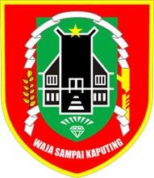<span class="irbi-prov-nama">Kalimantan Selatan</span><span class="irbi-prov-nilai">83,68</span><span class="kelas kelas-sedang">Sedang</span></a><a class="irbi-prov-kartu" data-kode="64" href="64-kalimantan-timur.html">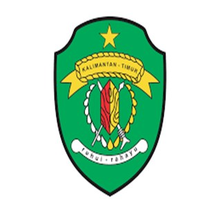<span class="irbi-prov-nama">Kalimantan Timur</span><span class="irbi-prov-nilai">117,73</span><span class="kelas kelas-sedang">Sedang</span></a><a class="irbi-prov-kartu" data-kode="65" href="65-kalimantan-utara.html">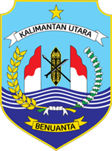<span class="irbi-prov-nama">Kalimantan Utara</span><span class="irbi-prov-nilai">121,35</span><span class="kelas kelas-sedang">Sedang</span></a><a class="irbi-prov-kartu" data-kode="71" href="71-sulawesi-utara.html">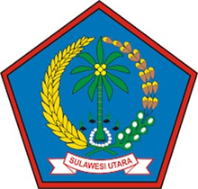<span class="irbi-prov-nama">Sulawesi Utara</span><span class="irbi-prov-nilai">178,90</span><span class="kelas kelas-tinggi">Tinggi</span></a><a class="irbi-prov-kartu" data-kode="72" href="72-sulawesi-tengah.html">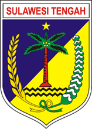<span class="irbi-prov-nama">Sulawesi Tengah</span><span class="irbi-prov-nilai">196,55</span><span class="kelas kelas-tinggi">Tinggi</span></a><a class="irbi-prov-kartu" data-kode="73" href="73-sulawesi-selatan.html">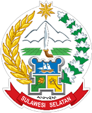<span class="irbi-prov-nama">Sulawesi Selatan</span><span class="irbi-prov-nilai">148,05</span><span class="kelas kelas-sedang">Sedang</span></a><a class="irbi-prov-kartu" data-kode="74" href="74-sulawesi-tenggara.html">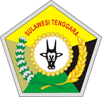<span class="irbi-prov-nama">Sulawesi Tenggara</span><span class="irbi-prov-nilai">195,78</span><span class="kelas kelas-tinggi">Tinggi</span></a><a class="irbi-prov-kartu" data-kode="75" href="75-gorontalo.html">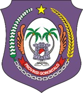<span class="irbi-prov-nama">Gorontalo</span><span class="irbi-prov-nilai">164,37</span><span class="kelas kelas-sedang">Sedang</span></a><a class="irbi-prov-kartu" data-kode="76" href="76-sulawesi-barat.html">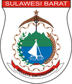<span class="irbi-prov-nama">Sulawesi Barat</span><span class="irbi-prov-nilai">211,46</span><span class="kelas kelas-tinggi">Tinggi</span></a><a class="irbi-prov-kartu" data-kode="81" href="81-maluku.html"><span class="irbi-prov-nama">Maluku</span><span class="irbi-prov-nilai">203,94</span><span class="kelas kelas-tinggi">Tinggi</span></a><a class="irbi-prov-kartu" data-kode="82" href="82-maluku-utara.html">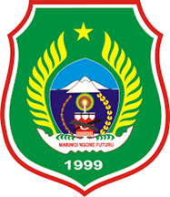<span class="irbi-prov-nama">Maluku Utara</span><span class="irbi-prov-nilai">220,33</span><span class="kelas kelas-tinggi">Tinggi</span></a><a class="irbi-prov-kartu" data-kode="91" href="91-papua.html">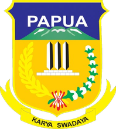<span class="irbi-prov-nama">Papua</span><span class="irbi-prov-nilai">218,52</span><span class="kelas kelas-tinggi">Tinggi</span></a><a class="irbi-prov-kartu" data-kode="92" href="92-papua-barat.html">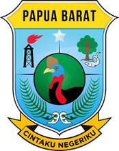<span class="irbi-prov-nama">Papua Barat</span><span class="irbi-prov-nilai">218,05</span><span class="kelas kelas-tinggi">Tinggi</span></a><a class="irbi-prov-kartu" data-kode="93" href="93-papua-selatan.html"><span class="irbi-prov-nama">Papua Selatan</span><span class="irbi-prov-nilai">165,40</span><span class="kelas kelas-sedang">Sedang</span></a><a class="irbi-prov-kartu" data-kode="94" href="94-papua-tengah.html">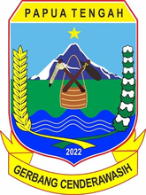<span class="irbi-prov-nama">Papua Tengah</span><span class="irbi-prov-nilai">193,46</span><span class="kelas kelas-tinggi">Tinggi</span></a><a class="irbi-prov-kartu" data-kode="95" href="95-papua-pegunungan.html">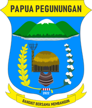<span class="irbi-prov-nama">Papua Pegunungan</span><span class="irbi-prov-nilai">193,09</span><span class="kelas kelas-tinggi">Tinggi</span></a><a class="irbi-prov-kartu" data-kode="96" href="96-papua-barat-daya.html">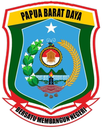<span class="irbi-prov-nama">Papua Barat Daya</span><span class="irbi-prov-nilai">230,78</span><span class="kelas kelas-tinggi">Tinggi</span></a></div>
```
