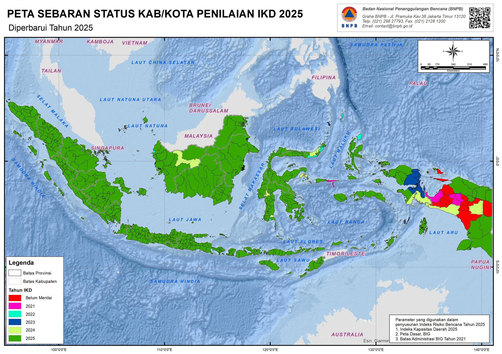

## Penilaian IKD Tahun 2025

Penilaian Indeks Ketahanan Daerah (IKD) tahun 2025 dilakukan oleh **469 kabupaten/kota**. Sebaran kelas
kapasitas kabupaten/kota disajikan pada @fig-ikd-grafik dan sebaran status penilaian pada @fig-ikd-peta.

{#fig-ikd-grafik width=80%}

{#fig-ikd-peta fig-alt="Peta sebaran status penilaian IKD kabupaten/kota tahun 2025"}

::: {.irbi-kutipan}
Bahwa indikator dalam IKD dicapai oleh Pemerintah Daerah, **bukan** hanya BPBD saja.
:::

## Metodologi Analisis Tingkat Risiko Bencana Kabupaten/Kota

### 1. Klasifikasi Data

Data yang digunakan merupakan data hasil kajian risiko yang terdiri dari data: 1) bahaya per jenis bencana,
2) jiwa terpapar per jenis bencana, 3) kerugian rupiah per jenis bencana, 4) kerusakan lingkungan (ha) per
jenis bencana dan 5) kapasitas pemerintah daerah per kabupaten/kota.

### 2. Pembobotan

Penentuan bobot per jenis bahaya (parameter 1) ditentukan berdasarkan hubungan antara frekuensi kejadian
dengan adanya tidak peringatan. Tabel klasifikasi tingkat risiko bencana pada kabupaten/kota memperlihatkan
bobot per jenis bahaya dan nilai tingkat bahaya 1 untuk rendah, 2 untuk sedang, dan 3 untuk tinggi.

Bobot kerentanan (parameter 2) berbeda untuk masing-masing jenis bahaya yang dihitung berdasarkan indeks
penduduk terpapar dalam jiwa, kerugian dalam rupiah, dan kerusakan lingkungan dalam hektar.

Komponen kapasitas (parameter 3) disusun untuk semua jenis bencana berdasarkan parameter kapasitas regulasi,
kelembagaan, sistem peringatan dini, pendidikan, pelatihan, keterampilan, mitigasi, dan sistem kesiapsiagaan.

Masing-masing parameter kemudian dikelompokkan menjadi 3 kelas yang kemudian digunakan untuk menghitung
Indeks Risiko Bencana dengan menggunakan rumus risiko.

Penentuan interval kelas masing-masing indeks jenis bencana dilakukan menggunakan nilai indeks dari kelas 1
untuk rendah, kelas 2 untuk sedang, dan kelas 3 untuk tinggi.

Penentuan skor untuk masing-masing parameter dilakukan dengan metode pengkalian antara kelas (1, 2, dan 3)
dengan bobot yang telah ditentukan. Skor masing-masing parameter kemudian dijumlahkan secara keseluruhan
untuk memperoleh skor total bencana di wilayah kabupaten. Tabel berikut menjelaskan detail parameter, kelas,
bobot, dan skor yang digunakan dalam metode ini.

### 3. Skoring

Skoring adalah melakukan operasi matematika dengan perkalian antara bobot dan nilai kelas yang telah dibuat.
Dalam satu kabupaten/kota, jumlah nilai skoring menunjukkan klasifikasi risiko kabupaten/kota tersebut.

### Klasifikasi tingkat risiko bencana pada kabupaten/kota

Pada tabel-tabel berikut, kolom **Skor** adalah hasil kali kelas (1, 2, 3) dengan bobot.

| No. | Parameter | Bobot | Skor kelas 1 | Skor kelas 2 | Skor kelas 3 |
|:---:|:----------|:-----:|:-----:|:-----:|:-----:|
| 1 | Gempabumi | 4 | 4 | 8 | 12 |
| 2 | Tsunami | 4 | 4 | 8 | 12 |
| 3 | Letusan Gunung Api | 3 | 3 | 6 | 9 |
| 4 | Banjir | 4 | 4 | 8 | 12 |
| 5 | Tanah Longsor | 5 | 5 | 10 | 15 |
| 6 | Kekeringan | 4 | 4 | 8 | 12 |
| 7 | Kebakaran Hutan dan Lahan | 4 | 4 | 8 | 12 |
| 8 | Cuaca Ekstrem | 4 | 4 | 8 | 12 |
| 9 | Gelombang Ekstrem dan Abrasi | 4 | 4 | 8 | 12 |
| 10 | Banjir Bandang | 4 | 4 | 8 | 12 |
| 11 | Likuefaksi | 4 | 4 | 8 | 12 |

: A. Bahaya (H) — nilai 100% {#tbl-bahaya}

| No. | Parameter | Bobot | Kelas 1: < 500 | Kelas 2: 500–1.000 | Kelas 3: > 1.000 |
|:---:|:----------|:-----:|:-----:|:-----:|:-----:|
| 1 | Gempabumi | 40% | 0,4 | 0,8 | 1,2 |
| 2 | Tsunami | 40% | 0,4 | 0,8 | 1,2 |
| 3 | Letusan Gunung Api | 40% | 0,4 | 0,8 | 1,2 |
| 4 | Banjir | 40% | 0,4 | 0,8 | 1,2 |
| 5 | Tanah Longsor | 40% | 0,4 | 0,8 | 1,2 |
| 6 | Kekeringan | 40% | 0,4 | 0,8 | 1,2 |
| 7 | Kebakaran Hutan dan Lahan | 30% | 0,3 | 0,6 | 0,9 |
| 8 | Cuaca Ekstrem | 40% | 0,4 | 0,8 | 1,2 |
| 9 | Gelombang Ekstrem dan Abrasi | 40% | 0,4 | 0,8 | 1,2 |
| 10 | Banjir Bandang | 40% | 0,4 | 0,8 | 1,2 |
| 11 | Likuefaksi | 40% | 0,4 | 0,8 | 1,2 |

: B. Kerentanan (V) — 1. Jiwa terpapar (jiwa per kilometer persegi) {#tbl-jiwa}

| No. | Parameter | Bobot | Kelas 1: < 1,55 | Kelas 2: 1,55–3,30 | Kelas 3: > 3,30 |
|:---:|:----------|:-----:|:-----:|:-----:|:-----:|
| 1 | Gempabumi | 60% | 0,6 | 1,2 | 1,8 |
| 2 | Tsunami | 50% | 0,5 | 1 | 1,5 |
| 3 | Letusan Gunung Api | 50% | 0,5 | 1 | 1,5 |
| 4 | Banjir | 50% | 0,5 | 1 | 1,5 |
| 5 | Tanah Longsor | 50% | 0,5 | 1 | 1,5 |
| 6 | Kekeringan | 30% | 0,3 | 0,6 | 0,9 |
| 7 | Kebakaran Hutan dan Lahan | 30% | 0,3 | 0,6 | 0,9 |
| 8 | Cuaca Ekstrem | 60% | 0,6 | 1,2 | 1,8 |
| 9 | Gelombang Ekstrem dan Abrasi | 50% | 0,5 | 1 | 1,5 |
| 10 | Banjir Bandang | 50% | 0,5 | 1 | 1,5 |
| 11 | Likuefaksi | 50% | 0,5 | 1 | 1,5 |

: B. Kerentanan (V) — 2. Kerugian (miliar rupiah) {#tbl-kerugian}

| No. | Parameter | Bobot | Kelas 1 | Kelas 2 | Kelas 3 |
|:---:|:----------|:-----:|:-----:|:-----:|:-----:|
| 1 | Gempabumi | 0% | 0 → 0 | 0 → 0 | 0 → 0 |
| 2 | Tsunami | 10% | < 55 → 0,1 | 55–155 → 0,2 | > 155 → 0,3 |
| 3 | Letusan Gunung Api | 10% | < 65 → 0,1 | 65–185 → 0,2 | > 185 → 0,3 |
| 4 | Banjir | 10% | < 70 → 0,1 | 70–205 → 0,2 | > 205 → 0,3 |
| 5 | Tanah Longsor | 10% | < 65 → 0,1 | 65–185 → 0,2 | > 185 → 0,3 |
| 6 | Kekeringan | 30% | < 65 → 0,3 | 65–185 → 0,6 | > 185 → 0,9 |
| 7 | Kebakaran Hutan dan Lahan | 40% | < 65 → 0,4 | 65–185 → 0,8 | > 185 → 1,2 |
| 8 | Cuaca Ekstrem | 0% | 0 → 0 | 0 → 0 | 0 → 0 |
| 9 | Gelombang Ekstrem dan Abrasi | 10% | < 70 → 0,1 | 70–205 → 0,2 | > 205 → 0,3 |
| 10 | Banjir Bandang | 10% | < 70 → 0,1 | 70–205 → 0,2 | > 205 → 0,3 |
| 11 | Likuefaksi | 10% | < 65 → 0,1 | 65–185 → 0,2 | > 185 → 0,3 |

: B. Kerentanan (V) — 3. Kerusakan lingkungan (hektar); format: rentang nilai → skor {#tbl-lingkungan}

| No. | Parameter | Bobot | Kelas 1: < 0,40 | Kelas 2: 0,40–0,80 | Kelas 3: > 0,80 |
|:---:|:----------|:-----:|:-----:|:-----:|:-----:|
| 1 | Kapasitas Daerah | 100% | 1 | 2 | 3 |

: C. Kapasitas (C) {#tbl-kapasitas}

| Jenis bencana | Kelas risiko | C = 1 | C = 2 | C = 3 |
|:--------------|:-------------|------:|------:|------:|
| Gempabumi, Tsunami, Banjir, Kekeringan, Kebakaran Hutan dan Lahan, Cuaca Ekstrem, Gelombang Ekstrem dan Abrasi, Banjir Bandang, Likuefaksi | Rendah | 4,00 | 2,00 | 1,33 |
|  | Sedang | 16,00 | 8,00 | 5,33 |
|  | Tinggi | 36,00 | 18,00 | 12,00 |
| Letusan Gunung Api | Rendah | 3,00 | 1,50 | 1,00 |
|  | Sedang | 12,00 | 6,00 | 4,00 |
|  | Tinggi | 27,00 | 13,50 | 9,00 |
| Tanah Longsor | Rendah | 5,00 | 2,50 | 1,67 |
|  | Sedang | 20,00 | 10,00 | 6,67 |
|  | Tinggi | 45,00 | 22,50 | 15,00 |

: D. Indeks risiko per kelas kapasitas (R = H × V / C) {#tbl-indeks-kapasitas}

::: {.callout-note appearance="simple"}
Pada tabel kapasitas di buku asli tertulis "0,40 - 80"; pada edisi digital ini ditulis 0,40–0,80 sesuai
urutan kelasnya.
:::
