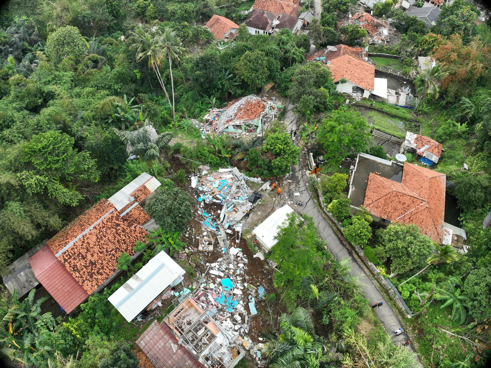

{.irbi-foto-bab fig-alt="Foto udara kawasan permukiman terdampak bencana"}

## Perhitungan IRBI Tahun 2025

Berdasarkan hasil penghitungan tahun 2025, rata-rata IRBI nasional tercatat sebesar 147,95. Nilai ini
merepresentasikan kondisi risiko aktual nasional dan disusun dari komponen bahaya berbasis data tahun 2021,
komponen kerentanan berdasarkan hasil proyeksi, serta komponen kapasitas yang menggunakan nilai aktual Indeks
Ketahanan Daerah (IKD) Tahun 2025. Angka tersebut menjadi rujukan utama dalam membaca kondisi risiko terkini
dan menetapkan prioritas intervensi kebijakan pada tahun berjalan.

IRBI 2025 sebagai nilai risiko aktual perlu dipahami sebagai hal yang berbeda dari nilai IRBI nasional yang
tercantum dalam kerangka perencanaan RPJMN 2025-2029 sebagai baseline target tahun 2025. Sebagaimana
tercantum dalam Dokumen RPJMN 2025-2029, nilai IRBI nasional sebagai baseline target adalah sebesar 141,17.
Nilai ini berasal dari hasil proyeksi IRBI 2025–2045 yang disusun pada tahun 2024, menggunakan komponen bahaya
tahun 2021, komponen kerentanan hasil proyeksi jangka panjang, serta komponen kapasitas dari tren dataset
2018–2023. Dengan demikian, angka 141,17 berfungsi sebagai baseline perencanaan makro jangka menengah,
sedangkan nilai 147,95 mencerminkan pembaruan kondisi aktual berdasarkan kapasitas riil pada tahun 2025.

Perbedaan antara kedua angka tersebut memperlihatkan perbedaan pendekatan proyektif dan aktual dalam
pengukuran, serta dinamika pembaruan data, dan tidak menunjukkan perubahan metodologi maupun deviasi terhadap
arah kebijakan RPJMN.

Untuk menjaga konsistensi pemantauan tahunan, dilakukan perhitungan tren IRBI 2024–2025 menggunakan komponen
bahaya dan kerentanan berbasis baseline data tahun 2021, sementara komponen kapasitas menggunakan IKD
masing-masing tahun. Dengan pendekatan ini, nilai IRBI nasional tercatat sebesar 171,95 pada tahun 2024 dan
170,17 pada tahun 2025, mencerminkan penurunan sebesar 1,03%.

Hal ini menunjukkan bahwa tren nilai IRBI 2024–2025 mengalami penurunan sebesar 1,03 persen. Penurunan ini
mengindikasikan adanya perbaikan kapasitas daerah yang berkontribusi terhadap pengurangan risiko secara
bertahap, meskipun tingkat risiko nasional secara keseluruhan masih memerlukan penguatan kebijakan yang
berkelanjutan untuk mencapai target RPJMN.



## Pengkelasan Indeks Risiko

Pengkelasan indeks risiko ditentukan berdasarkan ambang batas sebagai berikut:

1. **Indeks Risiko Rendah:** Ambang batas bawah diperoleh dari kondisi indeks bahaya rendah dan indeks
   kapasitas tinggi. Nilai ambang batas per jenis bencana adalah 1,0 untuk letusan gunung api, 1,67 untuk
   tanah longsor, dan 1,33 untuk sembilan jenis bencana lainnya. Dengan demikian, nilai ambang batas agregat
   untuk 11 jenis bencana adalah 14,67.
2. **Indeks Risiko Sedang:** Ambang batas bawah diperoleh dari kondisi indeks bahaya sedang dan indeks
   kapasitas rendah. Nilai ambang batas per jenis bencana adalah 12,0 untuk letusan gunung api, 20,0 untuk
   tanah longsor, dan 16,0 untuk sembilan jenis bencana lainnya. Dengan demikian, nilai ambang batas agregat
   untuk 11 jenis bencana adalah 176,0.
3. **Indeks Risiko Tinggi:** Daerah dikategorikan berisiko tinggi apabila nilai indeks risiko agregat
   melebihi ambang batas bawah indeks risiko sedang, yaitu di atas 176,0.

Rentang nilai yang digunakan dalam klasifikasi Indeks Risiko Bencana tahun 2025 adalah sebagai berikut:

| Kelas | Nilai IRBI |
|:------|:-----------|
| [Rendah]{.kelas .kelas-rendah} | < 14,67 |
| [Sedang]{.kelas .kelas-sedang} | 14,67 – 176,00 |
| [Tinggi]{.kelas .kelas-tinggi} | > 176,00 |

: Kelas Indeks Risiko Bencana Indonesia (IRBI) {#tbl-kelas-irbi}

## Indeks Risiko Bencana Tingkat Provinsi



Kolom **SEB** ditampilkan sesuai kolom pada tabel provinsi di buku asli. Nilai provinsi tahun 2025 sama
dengan rata-rata skor kabupaten/kota di provinsi tersebut.

::: {.content-visible when-format="html"}
```{=html}
<div class="irbi-panel"><h3>Nilai Indeks Risiko Bencana provinsi tahun 2025</h3><div class="irbi-grafik" data-jenis="provinsi"></div></div>
```
:::

::: {.content-visible when-format="typst"}
{#fig-grafik-provinsi}
:::

## Peta Indeks Risiko Bencana Tingkat Provinsi


