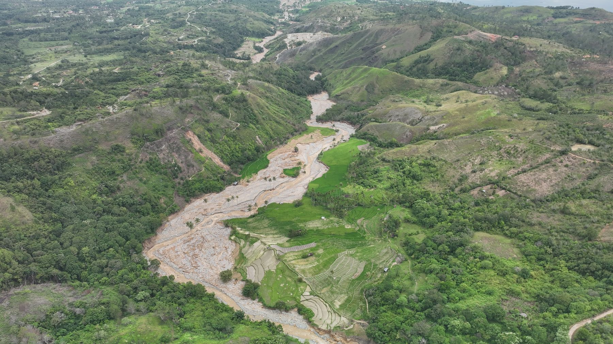

::: {.content-visible when-format="html"}
```{=html}
<section class="irbi-hero">
  
  <div class="irbi-hero-teks">
    <p class="irbi-hero-label">Volume 04 · Nomor 04 · Januari 2026 · ISSN 2985-6922</p>
    <div class="irbi-hero-judul" role="heading" aria-level="2">Indeks Risiko Bencana Indonesia <span>Tahun 2025</span></div>
    <p>Edisi digital interaktif buku IRBI 2025 terbitan Badan Nasional Penanggulangan Bencana. Jelajahi risiko 514
    kabupaten/kota dan 38 provinsi untuk 11 jenis ancaman, saring sesuai kebutuhan, lalu unduh peta dan datanya.</p>
    <div class="irbi-hero-aksi">
      <a class="btn btn-irbi" href="jelajah.html"><i class="bi bi-map"></i> Jelajah Data</a>
      <a class="btn btn-outline-irbi" href="provinsi/index.html"><i class="bi bi-geo-alt"></i> Per provinsi</a>
      <a class="btn btn-outline-irbi" href="IRBI-2025.pdf" download><i class="bi bi-file-earmark-pdf"></i> Buku PDF</a>
    </div>
  </div>
</section>
<nav class="irbi-pintasan" aria-label="Pintasan utama">
  <a href="jelajah.html"><i class="bi bi-map"></i><b>Jelajah Data</b><span>Peta &amp; tabel tersinkron, filter lengkap, profil wilayah, PDF sesuai filter.</span></a>
  <a href="hasil-provinsi.html"><i class="bi bi-bar-chart-line"></i><b>Hasil Analisis</b><span>Nilai IRB nasional, 38 provinsi, dan 514 kabupaten/kota.</span></a>
  <a href="provinsi/index.html"><i class="bi bi-buildings"></i><b>Profil Provinsi</b><span>Profil wilayah, ancaman, peta, dan tabel tiap provinsi.</span></a>
  <a href="ancaman/index.html"><i class="bi bi-cloud-lightning-rain"></i><b>Per Ancaman</b><span>Banjir, gempabumi, tsunami, hingga cuaca ekstrem.</span></a>
  <a href="unduhan.html"><i class="bi bi-download"></i><b>Unduhan</b><span>Buku PDF, peta siap cetak, dan data CSV/GeoJSON.</span></a>
  <a href="studio.html"><i class="bi bi-palette2"></i><b>Studio</b><span>Ubah data, tampilan, dan teks langsung di aplikasi.</span></a>
</nav>
```
:::

Buku **Indeks Risiko Bencana Indonesia (IRBI) Tahun 2025** menyajikan Indeks Risiko Bencana pada tingkat
kabupaten/kota dan provinsi, serta agregasi nasional, untuk sebelas jenis ancaman: banjir, gempabumi,
tsunami, letusan gunung api, banjir bandang, gelombang ekstrem dan abrasi, kebakaran hutan dan lahan, tanah
longsor, kekeringan, likuefaksi, dan cuaca ekstrem.



::: {.content-visible when-format="html"}
## Sorotan

```{=html}
<div class="irbi-dua-kolom">
  <div class="irbi-panel"><h3>Skor tertinggi</h3><div class="irbi-grafik" data-jenis="teratas"></div></div>
  <div class="irbi-panel"><h3>Sebaran kelas risiko per ancaman</h3><div class="irbi-grafik" data-jenis="ancaman"></div></div>
</div>
```

## Cara menggunakan edisi digital

- **Jelajah Data.** Saring menurut jenis indeks, provinsi, kelas, rentang skor, atau nama wilayah. Peta,
  tabel, kartu ringkasan, dan grafik berubah bersamaan, dan tautan halaman menyimpan filter Anda sehingga bisa
  dibagikan.
- **PDF sesuai filter.** Tombol *Unduh PDF sesuai filter* membuat PDF di peramban: peta berketerangan
  (legenda, skala, arah utara), ringkasan statistik, klasifikasi kelas, parameter, dan tabel data lengkap
  untuk semua indeks.
- **Studio.** Tombol *Studio* di pojok kanan bawah membuka panel untuk mengubah warna, huruf, ukuran teks,
  mode gelap, teks halaman, dan data, tanpa mengubah kode atau memerlukan server. Perubahan bisa diekspor,
  dibagikan, atau diterbitkan untuk semua pembaca.
- **Mode baca & gelap.** Gunakan ikon di bilah atas untuk mode baca (menyembunyikan navigasi) dan mode gelap.
:::

## Tim Redaksi

Pengarah
: Raditya Jati — Deputi Bidang Sistem dan Strategi BNPB

Penanggung Jawab
: Udrekh — Direktur Pemetaan dan Evaluasi Risiko Bencana BNPB

Editor
: Ridwan Yunus; Hafiz Fatah N.A.

Desain dan Tata Letak
: Atikah Nurina Sari; Putri Wibawanti

Atribusi Foto
: Dokumentasi Pusdatinkomben, BNPB

Penulis
: Edy S. Purba; Dyah Rusmiasih; Trevi Jayanti P.; Afif Alfian; Hannura Ayu S.; Sesa Wiguna;
  Asfirmanto W. Adi; Dian Ika Purnamasiwi; Ahmad Rizqi; Franta Eveline; Rafa Karimah; Anggara S. Putra;
  Yusuf Bagaskoro; Afifa Nomita Dewi; Brian M. A. Situngkir; Fajri Ramadhan; Intan Arianti;
  M. Bintang W. Nugraha; M. Firman Hafizh; Natasya Safetyani; Alicya Grace Berutu; Hafiz Fatah N.A.;
  Aulia Ishmata; Abdul Hafizh; Rahmawati; Atikah Nurina Sari; Devy Cynthia Selina; Harly M. Siambaton;
  Helin Avinnata; Nanda Aviori Nazar; Rias Sukmawati; Viola Debby Yulistya; Prihatin Ningsih;
  Putri Wibawanti; Angguna Noviana

Kontributor
: Intan Prawesti; Lir Ayyu Azzaqia Selasih; Aqiela Pradani Ulin Nuha

## Penerbit

Diterbitkan oleh **Badan Nasional Penanggulangan Bencana**. Volume 04, Nomor 04, Januari 2026.
ISSN 2985-6922.

Hak cipta dilindungi undang-undang. Dilarang mengutip atau memperbanyak sebagian atau seluruh isi buku tanpa
izin tertulis penerbit.

::: {.callout-note appearance="simple"}
## Tentang edisi digital

Edisi ini dikonversi dari berkas *BUKU IRBI 2025.pdf*. Teks, tabel, dan nilai diambil dari buku asli. Peta
dibuat ulang dari tabel buku memakai batas wilayah administrasi Kepmendagri No. 300.2.2-2430 Tahun 2025 (data
[cahyadsn/wilayah_boundaries](https://github.com/cahyadsn/wilayah_boundaries), lisensi MIT), sehingga
tampilannya dapat berbeda dari peta cetak yang memakai batas administrasi BIG 2021. Perbedaan angka yang
ditemukan antarbagian buku asli diberi catatan pada halaman terkait.
:::
