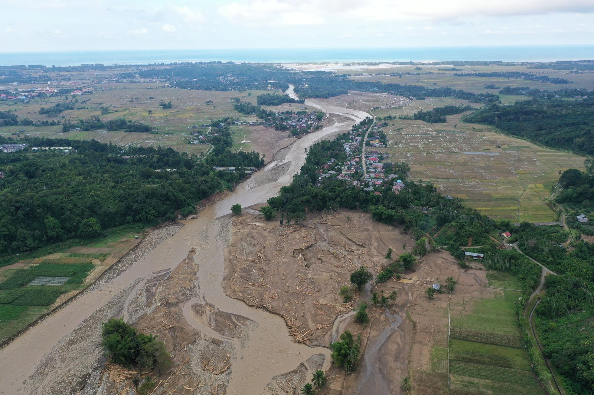

{.irbi-foto-bab fig-alt="Foto udara wilayah terdampak banjir bandang"}

## Metodologi Pengkajian Risiko

Nilai IRBI berlandaskan pada pengkajian risiko bencana, yaitu suatu pendekatan sistematis untuk mengidentifikasi potensi dampak negatif yang ditimbulkan oleh ancaman bencana di suatu wilayah.

Pengkajian ini mempertimbangkan tiga komponen utama pembentuk risiko, yaitu bahaya, kerentanan, dan kapasitas wilayah. Bahaya bencana didefinisikan sebagai suatu situasi, kondisi, atau karakteristik biologis, geografis, geologis, klimatologis, sosial, ekonomi, politik, budaya, dan teknologi suatu masyarakat di suatu wilayah untuk jangka waktu tertentu yang berpotensi menimbulkan korban dan kerusakan. Tingkat bahaya dihitung berdasarkan probabilitas spasial, frekuensi, dan kekuatan dari suatu ancaman.

Kerentanan adalah suatu kondisi dari suatu komunitas atau masyarakat yang mengarah atau menyebabkan ketidakmampuan untuk mencegah, menjinakkan, mencapai kesiapan, dan menanggapi dampak bahaya tertentu. Dimensi kerentanan dalam IRBI mencakup kerentanan sosial budaya, fisik, ekonomi dan lingkungan.

Kapasitas adalah gabungan dari semua kekuatan, karakteristik, dan sumber daya yang tersedia dalam sebuah komunitas, masyarakat, atau organisasi yang dapat digunakan untuk melaksanakan tindakan guna mengurangi tingkat ancaman dan/atau tingkat kerugian akibat bencana serta mencapai tujuan penanggulangan bencana yang telah disepakati.

Interaksi ketiga komponen tersebut digunakan untuk menghitung potensi risiko bencana, yang meliputi sebaran bahaya, potensi jiwa terpapar, kerugian harta benda, kerusakan lingkungan, serta kapasitas penanggulangan bencana. Secara matematis, potensi risiko diformulasikan sebagai berikut:

$$
Risiko\ (R) \approx Bahaya\ (H) \times \frac{Kerentanan\ (V)}{Kapasitas\ (C)}
$$

Secara umum, tahapan pengkajian risiko bencana mencakup akuisisi data, pengolahan dan analisis data, serta penyajian hasil kajian dalam bentuk indeks secara tabular dan spasial. Pengkajian risiko bencana dilaksanakan berdasarkan prinsip-prinsip berikut:

1) Menggunakan data dan informasi yang mengutamakan sumber resmi dari lembaga yang berwenang;
2) Mengintegrasikan analisis probabilitas kejadian bencana berdasarkan masukan dari walidata, para pakar, dan kearifan lokal;
3) Proses analisis harus mampu menghasilkan estimasi jumlah jiwa terpapar, kerugian harta benda, kerusakan lingkungan terpapar;
4) Hasil kajian risiko dapat diterjemahkan menjadi kebijakan pengurangan risiko bencana.

## Metodologi Analisis Data

Indeks Risiko Bencana dipengaruhi oleh komponen penyusunnya, yaitu bahaya, kerentanan, dan kapasitas. Pengaruh masing-masing komponen (bobot) dalam penentuan Indeks Risiko Bencana adalah 40% dari komponen bahaya, 30% dari komponen kerentanan, dan 30% dari komponen kapasitas.

Tingkat bahaya dihitung berdasarkan probabilitas spasial, frekuensi, dan kekuatan dari suatu fenomena alam. Jenis bencana yang dimasukkan ke dalam perhitungan IRBI 2025 adalah banjir, banjir bandang, tanah longsor, gempabumi, tsunami, likuefaksi, letusan gunung api, cuaca ekstrem, kekeringan, kebakaran hutan dan lahan, dan gelombang ekstrem dan abrasi. Dalam perhitungan IRBI 2025, data bahaya menggunakan baseline data tahun 2021 yang disusun oleh BNPB. Baseline ini merupakan pembaruan dari IRBI tahun 2015-2024 yang menggunakan data bahaya tahun 2013.

Komponen kerentanan pada perhitungan IRBI 2025 menggunakan data hasil Proyeksi Kerentanan yang disusun oleh BNPB bersama Kementerian PPN/Bappenas sebagai bagian dari indikator proksi dalam Rencana Pembangunan Jangka Panjang Nasional (RPJPN) 2025-2045. Proyeksi kerentanan diukur menggunakan metode statistik dan spasial untuk memperkirakan nilai kerentanan pada tahun tertentu dengan memperhatikan kecenderungan pertumbuhan penduduk, perubahan tutupan lahan, perkembangan kawasan terbangun, dan pertumbuhan ekonomi. Berbeda dengan nilai IRB tahun sebelumnya yang menggunakan data kerentanan yang konstan setiap tahun (baseline data 2013), data kerentanan dalam perhitungan IRBI 2025 dan selanjutnya akan bersifat dinamis sesuai nilai hasil proyeksi kerentanan setiap tahun.

Pembaruan basis data bahaya dan kerentanan pada perhitungan IRBI tahun 2025 ini dimaksudkan agar IRBI sebagai sebuah instrumen penilaian risiko bencana mampu memberikan gambaran yang lebih representatif dan dapat dipercaya untuk membaca kondisi risiko dan menetapkan prioritas intervensi pada tahun berjalan.

Adapun komponen kapasitas menggunakan data yang sama yang dipakai pada perhitungan IRBI pada tahun-tahun sebelumnya, yaitu hasil penilaian Indeks Ketahanan Daerah (IKD) tahun berjalan dari masing-masing kabupaten/kota. Komponen kapasitas ini dinilai merupakan aspek yang paling dapat menggambarkan capaian penanggulangan bencana di daerah.

Pada tahun 2025, kabupaten/kota yang melakukan penilaian IKD pada tahun 2025 berjumlah 469 kabupaten/kota. Jumlah ini meningkat jika dibandingkan dengan tahun 2024 yang berjumlah 445 kabupaten/kota. Sebaran penilaian IKD kabupaten/kota dapat dilihat pada bagian Penilaian IKD Tahun 2025 berikut.


