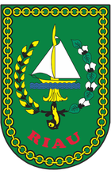

{.irbi-lambang fig-alt="Lambang Riau" width=0.8in}



## Profil Wilayah

Provinsi Riau beribukota di Kota Pekanbaru memiliki luas wilayah 89.935,90 km². Wilayah administrasi Provinsi Riau terdiri dari 10 kabupaten dan 2 kota dengan jumlah penduduk di tahun 2025 mencapai 6,8 juta jiwa (BPS, 2025).

Secara geografis, Provinsi Riau terletak di bagian tengah Pulau Sumatera, membentang dari lereng timur Bukit Barisan hingga ke pesisir Selat Malaka, dengan topografi berupa dataran rendah. Dataran rendah tersebut berkisar 0-5 meter dpl terutama di wilayah pesisir. Menurut dokumen perencanaan daerah (RPJMD Provinsi Riau 2025- 2029), sebagian besar daratan Riau terbentuk dari endapan tanah muda dan memiliki hamparan lahan gambut yang sangat luas serta tebal, yang berfungsi sebagai penyimpan cadangan air dan karbon alami yang besar. Kondisi ini membuat tanah Provinsi Riau cenderung datar dan stabil dari guncangan gempa besar dibandingkan daerah tetangganya, namun disisi lain, tanahnya menjadi sangat lunak dan sensitif terhadap perubahan lingkungan, terutama di area rawa dan pesisirnya. Provinsi Riau memiliki iklim tropis basah.

Berdasarkan Data dan Informasi Bencana Indonesia (DIBI) tahun 2025, bencana yang paling banyak terjadi adalah kebakaran hutan dan lahan, serta banjir. Pengukuran Indeks Risiko Bencana Indonesia (IRBI) 2025, Provinsi Riau memiliki kelas risiko Sedang dengan nilai 118,15.



::: {.callout-note appearance="simple" icon=false}
## Ancaman Bencana

Banjir, Banjir Bandang, Cuaca Ekstrem, Gelombang Ekstrem dan Abrasi, Gempa Bumi, Kekeringan, Kebakaran Hutan dan Lahan, Likuefaksi, dan Tanah Longsor.
:::

## Peta Indeks Risiko Bencana



## Tabel Nilai Indeks Risiko


