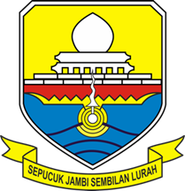

{.irbi-lambang fig-alt="Lambang Jambi" width=0.8in}



## Profil Wilayah

Provinsi Jambi dengan ibukota di Kota Jambi, terdiri dari 9 kabupaten dan 2 kota. Memiliki luas wilayah 49.026,58 km² dengan jumlah penduduk di tahun 2025 mencapai 3,76 juta jiwa (BPS,2025).

Wilayah Provinsi Jambi membentang dari puncak gunung di bagian Barat hingga ke wilayah pesisir di bagian Timur yang menghadap Selat Berhala, yang merupakan bagian dari jalur pelayaran internasional di dekat Selat Malaka. Kondisi topografinya merupakan perpaduan antara dataran tinggi dan dataran rendah. Secara geologis, Provinsi Jambi memiliki zona tektonik yaitu di wilayah Kerinci dan Merangin dan zona cekungan sedimen di wilayah timur. Kondisi klimatologi di Provinsi Jambi secara umum memiliki iklim tropis (RPJMD Provinsi Jambi 2021 - 2026) dengan curah hujan tahunan pada tahun 2024 sebesar 2408 mm/tahun.

Berdasarkan Data dan Informasi Bencana Indonesia (DIBI) tahun 2025, bencana yang paling banyak terjadi adalah banjir serta kebakaran hutan dan lahan. Pengukuran Indeks Risiko Bencana Indonesia (IRBI) 2025, Provinsi Jambi memiliki kelas risiko Sedang dengan nilai 132,45.



::: {.callout-note appearance="simple" icon=false}
## Ancaman Bencana

Banjir, Banjir Bandang, Cuaca Ekstrem, Gelombang Ekstrem dan Abrasi, Gempa Bumi, Likuefaksi, Kebakaran Hutan dan Lahan, Letusan Gunung Api, Kekeringan, dan Tanah Longsor.
:::

## Peta Indeks Risiko Bencana



## Tabel Nilai Indeks Risiko


