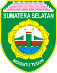

{.irbi-lambang fig-alt="Lambang Sumatera Selatan" width=0.8in}



## Profil Wilayah

Provinsi Sumatera Selatan beribukota di Kota Palembang dengan luas wilayah 88.671,68 km². Wilayah administrasi Provinsi Sumatera Selatan terdiri dari 13 kabupaten dan 4 kota, dengan jumlah penduduk di tahun 2025 mencapai 8,92 juta jiwa (BPS, 2025).

Topografi pada Provinsi Sumatera Selatan berupa pantai, dataran rendah, dataran tinggi, perbukitan, dan pegunungan. Wilayah Sumatera Selatan memiliki bentang wilayah dari Barat ke Timur dengan ketinggian 400-1.700 meter diatas permukaan laut (mdpl). Secara geologis, jenis struktur yang umum dijumpai di cekungan Sumatera Selatan terdiri dari lipatan, sesar dan kekar. Secara klimatologi, Provinsi Sumatera Selatan merupakan wilayah beriklim tropis. Selama tahun 2024 suhu rata-rata di seluruh wilayah Provinsi Sumatera Selatan adalah 28,4ºC, dengan jumlah curah hujan setinggi 3.151,9 mm dan jumlah hari hujan sebanyak 314 hari.

Berdasarkan Data dan Informasi Bencana Indonesia (DIBI) tahun 2025, bencana yang paling banyak terjadi adalah banjir serta kebakaran hutan dan lahan. Pengukuran Indeks Risiko Bencana Indonesia (IRBI) 2025, Provinsi Sumatera Selatan memiliki kelas risiko Sedang dengan nilai 139,67.



::: {.callout-note appearance="simple" icon=false}
## Ancaman Bencana

Banjir, Banjir Bandang, Cuaca Ekstrem, Gelombang Ekstrem Dan Abrasi, Gempa Bumi, Kekeringan, Kebakaran Hutan Dan Lahan, Letusan Gunung Api, Tanah Longsor, dan Likuefaksi.
:::

## Peta Indeks Risiko Bencana



## Tabel Nilai Indeks Risiko


