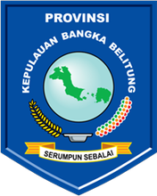

{.irbi-lambang fig-alt="Lambang Kepulauan Bangka Belitung" width=0.8in}



## Profil Wilayah

Provinsi Kepulauan Bangka Belitung beribukota di Kota PangkalPinang, dengan luas wilayah 16.690,13 km². Wilayah administrasi Provinsi Kepulauan Bangka Belitung terdiri dari 6 kabupaten dan 1 kota, dengan jumlah penduduk di tahun 2024 sebanyak 1,53 juta jiwa. (BPS, 2025)

Pulau Bangka didominasi oleh dataran rendah di wilayah pesisir dan perbukitan di wilayah tengah dan wilayah selatan dengan titik tertinggi di Gunung Maras. Sementara itu, Pulau Belitung memiliki karakteristik topografi perbukitan dan lembah sungai serta bukit-bukit granit yang ditemukan di beberapa tempat. Kondisi geologi pada Pulau Bangka dan Belitung termasuk bagian tengah dari “Tin Mayor South East Asian Tin Belt” dengan tipe granit main range yang mempunyai ciri-ciri megakristal (terutama K-Feldspar) dan terjadi mineralisasi timah serta mineral ikutannya. Kondisi klimatologi pada Provinsi Kepulauan Bangka Belitung memiliki iklim tropis dengan curah hujan tahun 2024 sebesar 1710 mm/tahun. (BPS, 2025)

Berdasarkan Data dan Informasi Bencana Indonesia (DIBI) tahun 2025, bencana yang paling banyak terjadi adalah banjir, kebakaran hutan dan lahan, serta cuaca ekstrem. Pengukuran Indeks Risiko Bencana Indonesia (IRBI) 2025, Provinsi Kepulauan Bangka Belitung memiliki kelas risiko Sedang dengan nilai 113,13.



::: {.callout-note appearance="simple" icon=false}
## Ancaman Bencana

Banjir, Banjir Bandang, Cuaca Ekstrem, Gelombang Ekstrem dan Abrasi, Gempa Bumi, Kekeringan, Kebakaran Hutan dan Lahan, dan Tanah Longsor.
:::

## Peta Indeks Risiko Bencana



## Tabel Nilai Indeks Risiko


