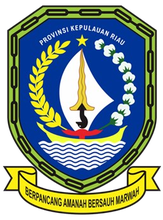

{.irbi-lambang fig-alt="Lambang Kepulauan Riau" width=0.8in}



## Profil Wilayah

Provinsi Kepulauan Riau beribukota di Kota Tanjungpinang, dengan luas wilayah 8.268,71 km². Wilayah administrasi Provinsi Kepulauan Riau terdiri dari 5 kabupaten dan 2 kota, dengan jumlah penduduk di tahun 2025 sebanyak 2,18 juta jiwa. (BPS, 2025)

Provinsi Kepulauan Riau memiliki 2.408 pulau. Sebagian besar daratan di pulau-pulaunya berupa perbukitan rendah dan dataran pantai yang sempit. Kondisi geologi pada Provinsi Kepulauan Riau merupakan bagian kontinental yang terkenal dengan nama “Paparan Sunda” atau bagian dari kerak Benua Asia. Kondisi iklim di Provinsi Kepulauan Riau sangat dipengaruhi oleh kondisi angin sehingga secara umum wilayah ini beriklim laut tropis basah. Terdapat musim kemarau dan musim hujan yang diselingi oleh musim pancaroba. (RPJMD Provinsi Kepulauan Riau 2021 - 2026)

Berdasarkan Data dan Informasi Bencana Indonesia (DIBI) tahun 2025, bencana yang paling banyak terjadi adalah banjir serta kebakaran hutan dan lahan. Pengukuran Indeks Risiko Bencana Indonesia (IRBI) 2025, Provinsi Kepulauan Riau memiliki kelas risiko Sedang dengan nilai 132,68.



::: {.callout-note appearance="simple" icon=false}
## Ancaman Bencana

Banjir, Banjir Bandang, Cuaca Ekstrem, Gelombang Ekstrem dan Abrasi, Gempa Bumi, Kekeringan, Kebakaran Hutan dan Lahan, dan Tanah Longsor.
:::

## Peta Indeks Risiko Bencana



## Tabel Nilai Indeks Risiko


