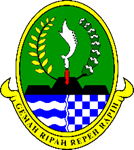

{.irbi-lambang fig-alt="Lambang Jawa Barat" width=0.8in}



## Profil Wilayah

Provinsi Jawa Barat beribukota di Kota Bandung, dengan luas wilayah 37.040,04 km². Wilayah administrasi Provinsi Jawa Barat terdiri dari 18 kabupaten dan 9 kota, dengan jumlah penduduk di tahun 2025 sebanyak 50,76 juta jiwa. (BPS, 2025)

Secara topografi, Provinsi Jawa Barat terdiri atas wilayah pegunungan curam di selatan, wilayah lereng bukit yang landai di tengah, wilayah dataran luas di utara, dan wilayah aliran sungai. Topografi mengidentifikasi ketinggian wilayah dari permukaan laut. Secara geologis, wilayah Jawa Barat terletak pada jalur Sirkum Pasifik dan mediteran, sehingga sebagian besar wilayahnya termasuk daerah labil yang ditandai dengan keberadaan 7 gunung berapi aktif, 5 sesar aktif serta aktivitas lempeng tektonik di selatan Jawa Barat. Kompleksitas struktur geologi di wilayah Jawa Barat ini menyebabkan wilayah ini memiliki tingkat kerentanan yang tinggi dari ancaman bencana alam. Kondisi klimatologi di wilayah Provinsi Jawa Barat termasuk tropis dengan suhu udara rata-rata antara 16° C – 34 °C dan curah hujan yang beragam. Curah hujan di Jawa Barat berada pada rentang curah hujan 1.000- 4.000 mm per tahun.

Berdasarkan Data dan Informasi Bencana Indonesia (DIBI) tahun 2025, bencana yang paling banyak terjadi adalah banjir, tanah longsor, dan cuaca ekstrem. Pengukuran Indeks Risiko Bencana Indonesia (IRBI) 2025, Provinsi Jawa Barat memiliki kelas risiko Sedang dengan nilai 106,02.



::: {.callout-note appearance="simple" icon=false}
## Ancaman Bencana

Banjir, Banjir Bandang, Cuaca Ekstrem, Gelombang Ekstrem dan Abrasi, Gempa Bumi, Kebakaran Hutan dan Lahan, Letusan Gunung Api, Kekeringan, Tanah Longsor dan Tsunami
:::

## Peta Indeks Risiko Bencana



## Tabel Nilai Indeks Risiko


