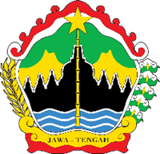

{.irbi-lambang fig-alt="Lambang Jawa Tengah" width=0.8in}



## Profil Wilayah

Provinsi Jawa Tengah beribukota di Kota Semarang, dengan luas wilayah 34.300 km². Wilayah administrasi Provinsi Jawa Tengah terdiri dari 29 kabupaten dan 6 kota, dengan jumlah penduduk di tahun 2025 sebanyak 38,23 juta jiwa. (BPS, 2025)

Wilayah Provinsi Jawa Tengah memiliki kondisi topografi yang bervariasi. Daerah pegunungan dan dataran tinggi membujur sejajar dengan panjang pulau Jawa di bagian tengah, dataran rendah hampir tersebar di seluruh wilayah, dan daerah pantai yaitu Pantai Utara dan Selatan. Kondisi geologi pada Provinsi Jawa Tengah terbagi menjadi 7 (tujuh) klasifikasi, yaitu Perbukitan Rembang, Zona Randublatung, Pegunungan Kendeng, Pegunungan Selatan Jawa Tengah bagian Timur, Pegunungan Serayu Utara, Pegunungan Serayu Selatan, dan Pegunungan Progo Barat. Kondisi iklim Jawa Tengah yang termasuk kategori iklim tropis basah yang cukup berpengaruh terhadap tingkat kesuburan tanah di wilayah Jawa Tengah. Curah hujan dipengaruhi oleh keadaan iklim, geografi dan perputaran/ pertemuan arus udara (RPJMD Provinsi Jawa Tengah 2025- 2029).

Suhu udara di Jawa Tengah berdasarkan data tahun 2024 berkisar antara 28,2°C sampai dengan 30°C.

Berdasarkan Data dan Informasi Bencana Indonesia (DIBI) tahun 2025, bencana yang paling banyak terjadi adalah banjir, tanah longsor, dan cuaca ekstrem. Pengukuran Indeks Risiko Bencana Indonesia (IRBI) 2025, Provinsi Jawa Tengah memiliki kelas risiko Sedang dengan nilai 92,37.



::: {.callout-note appearance="simple" icon=false}
## Ancaman Bencana

Banjir, Banjir Bandang, Cuaca Ekstrem, Gelombang Ekstrem dan Abrasi, Gempa Bumi, Kekeringan, Kebakaran Hutan dan Lahan, Letusan Gunung Api, Tanah Longsor, Likuefaksi, dan Tsunami.
:::

## Peta Indeks Risiko Bencana



## Tabel Nilai Indeks Risiko


