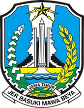

{.irbi-lambang fig-alt="Lambang Jawa Timur" width=0.8in}



## Profil Wilayah

Provinsi Jawa Timur beribukota di Kota Surabaya, dengan luas wilayah 48.036,84 km². Wilayah administrasi Provinsi Jawa Timur terdiri dari 29 kabupaten dan 9 kota, dengan jumlah penduduk di tahun 2025 sebanyak 41,81 juta jiwa. (BPS, 2025)

Sebagian besar wilayah Jawa Timur mempunyai karakteristik topografi daratan relatif datar. Secara geologis wilayah Provinsi Jawa Timur merupakan kawasan subur dengan berbagai jenis lapisan geologi seperti Halosen, Pleistosen, Pliosen, Miosen, dan Kwarter yang dipengaruhi adanya gunung api dan salah satunya adalah gunung tertinggi di Pulau Jawa yaitu Gunung Semeru. Jajaran pegunungan di Provinsi Jawa Timur tersebar mulai dari perbatasan di timur dengan adanya Gunung Lawu, Gunung Kelud, Gunung Semeru, Gunung Bromo, Gunung Argopuro, dan Gunung Ijen. Kondisi iklim Provinsi Jawa Timur dengan rata-rata curah hujan per bulan setinggi 178,9 mm dan rata-rata hari hujan per bulan sebanyak 22- 23 (22,7) hari.

Berdasarkan Data dan Informasi Bencana Indonesia (DIBI) tahun 2025, bencana yang paling banyak terjadi adalah banjir, cuaca ekstrem, kebakaran hutan dan lahan, serta tanah longsor. Pengukuran Indeks Risiko Bencana Indonesia (IRBI) 2025, Provinsi Jawa Timur memiliki kelas risiko Sedang dengan nilai 108,36.



::: {.callout-note appearance="simple" icon=false}
## Ancaman Bencana

Banjir, Banjir Bandang, Cuaca Ekstrem, Gelombang Ekstrem dan Abrasi, Gempa Bumi, Likuefaksi, Kebakaran Hutan dan Lahan, Letusan Gunung Api,Kekeringan, Tanah Longsor, dan Tsunami.
:::

## Peta Indeks Risiko Bencana



## Tabel Nilai Indeks Risiko


