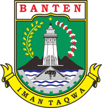

{.irbi-lambang fig-alt="Lambang Banten" width=0.8in}



## Profil Wilayah

Provinsi Banten beribukota di Kota Serang, dengan luas wilayah 9.352,77 km². Wilayah administrasi Provinsi Banten terdiri dari 4 kabupaten dan 4 kota, dengan jumlah penduduk di tahun 2025 sebanyak 13,53 juta jiwa. (BPS, 2025)

Kondisi topografi Provinsi Banten dibagi menjadi tiga kelompok. Kelompok pertama yaitu morfologi dataran rendah berkisar 0-50 mdpl, terdapat di bagian utara dan bagian selatan, Kelompok kedua yaitu morfologi perbukitan bergelombang rendah hingga sedang dengan ketinggian berkisar 50-200 mdpl, dan kelompok ketiga yaitu dataran tinggi dan pegunungan pada bagian wilayah selatan. Secara geologis struktur Provinsi Banten didominasi oleh struktur lipatan antiklin dan sinklin yang berarah barat-timur dan barat laut tenggara, sedangkan sesar didominasi oleh arah utara-selatan dan sebagian berarah barat laut-tenggara hingga barat daya-timur laut. Wilayah Provinsi Banten, sebagaimana wilayah lainnya di Indonesia, memiliki dua musim, yaitu musim hujan dan musim kemarau. Iklim wilayah Banten sangat dipengaruhi oleh Angin Muson dan Gelombang La Nina atau El Nino (RPJMD Provinsi Banten 2025-2029).

Berdasarkan Data dan Informasi Bencana Indonesia (DIBI) tahun 2025, bencana yang paling banyak terjadi adalah banjir dan cuaca ekstrem. Pengukuran Indeks Risiko Bencana Indonesia (IRBI) 2025, Provinsi Banten memiliki kelas risiko Sedang dengan nilai 103,58.



::: {.callout-note appearance="simple" icon=false}
## Ancaman Bencana

Banjir, Banjir Bandang, Cuaca Ekstrem, Gelombang Ekstrem dan Abrasi, Gempabumi, Kekeringan, Kebakaran Hutan dan Lahan, Letusan Gunung Api, Tanah Longsor, Likuefaksi, dan Tsunami.
:::

## Peta Indeks Risiko Bencana



## Tabel Nilai Indeks Risiko


