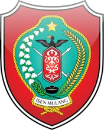

{.irbi-lambang fig-alt="Lambang Kalimantan Tengah" width=0.8in}



## Profil Wilayah

Provinsi Kalimantan Tengah beribukota di Kota Palangkaraya memiliki luas wilayah 153.443,9 km². Wilayah administrasi Provinsi Kalimantan Tengah terdiri dari 13 kabupaten dan 1 kota, dengan jumlah penduduk di tahun 2025 mencapai 2.844.990 jiwa (BPS Kalimantan Tengah, 2025).

Kondisi geologi pada Provinsi Kalimantan Tengah memiliki struktur geologi yang dipengaruhi oleh pergerakan lempeng tektonik dan adanya sesar-sesar mendatar seperti Sesar Barito. Secara umum, Provinsi Kalimantan Tengah dianggap stabil secara geologis dan relatif aman dari gempa bumi vulkanik. Topografi pada provinsi Kalimantan Tengah didominasi dataran rendah pada bagian selatan, tengah, dan menerus dari barat hingga ke timur. Titik tertinggi wilayah Provinsi Kalimantan Tengah terdapat di Gunung Batu Sambang dengan ketinggian mencapai 1.660 meter dpl. Iklim di Kalimantan Tengah pada tahun 2024 mempunyai temperatur suhu rata - rata berkisar antara 27 - 29 C dengan 5 titik kabupaten/kota terpanas yaitu Murung Raya, Lamandau, Kotawaringin Timur, Katingan, dan Seruyan (BPS, 2025).

Berdasarkan Data dan Informasi Bencana Indonesia (DIBI) tahun 2025, bencana yang paling banyak terjadi di Provinsi Kalimantan Tengah adalah kebakaran hutan dan lahan serta banjir. Pengukuran Indeks Risiko Bencana Indonesia (IRBI) tahun 2025 pada Provinsi Kalimantan Tengah memiliki kelas risiko Sedang dengan nilai 104,76.



::: {.callout-note appearance="simple" icon=false}
## Ancaman Bencana

Banjir, Banjir Bandang, Cuaca Ekstrem, Gelombang Ekstrem dan Abrasi, Gempabumi, Kekeringan, Kebakaran Hutan dan Lahan, Tanah Longsor, Tsunami.
:::

## Peta Indeks Risiko Bencana



## Tabel Nilai Indeks Risiko


