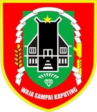

{.irbi-lambang fig-alt="Lambang Kalimantan Selatan" width=0.8in}



## Profil Wilayah

Provinsi Kalimantan Selatan beribukota di Kota Banjarbaru memiliki luas wilayah 37.135,054 km². Wilayah administrasi Provinsi Kalimantan Selatan terdiri dari 11 kabupaten dan 2 kota, dengan jumlah penduduk di tahun 2025 mencapai 4.323.330 jiwa (BPS Kalimantan Selatan, 2025).

Kondisi geologi pada Provinsi Kalimantan Selatan dipengaruhi oleh struktur geologi berupa sesar dan lipatan yang membentuk pegunungan Meratus membentang dengan arah barat daya - timur laut. Topografi pada provinsi Kalimantan Selatan didominasi dataran rendah pada bagian barat dan timur, dan dataran terjal pada bagian tengah. Curah hujan di Provinsi Kalimantan Selatan adalah sebanyak 2.930,80 mm/tahun. Sedangkan jumlah hari hujan di Provinsi Kalimantan Selatan tercatat terendah pada Stasiun Meteorologi Syamsudin Noor sebesar 297 hari dan tertinggi sebesar 316 hari.

Berdasarkan Data dan Informasi Bencana Indonesia (DIBI) tahun 2025, bencana yang paling banyak terjadi di Provinsi Kalimantan Selatan adalah bencana banjir, cuaca ekstrem, serta kebakaran hutan dan lahan. Pengukuran Indeks Risiko Bencana Indonesia (IRBI) tahun 2025 pada Provinsi Kalimantan Selatan memiliki kelas risiko Sedang dengan nilai 83,68.



::: {.callout-note appearance="simple" icon=false}
## Ancaman Bencana

Banjir, Banjir Bandang, Cuaca Ekstrem, Gelombang Ekstrem dan Abrasi, Gempabumi, Kebakaran Hutan dan Lahan, Kekeringan, Tanah Longsor, Tsunami.
:::

## Peta Indeks Risiko Bencana



## Tabel Nilai Indeks Risiko


