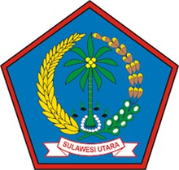

{.irbi-lambang fig-alt="Lambang Sulawesi Utara" width=0.8in}



## Profil Wilayah

Provinsi Sulawesi Utara beribukota di Kota Manado memiliki luas wilayah 14.500,28 km². Wilayah administrasi Provinsi Sulawesi Utara terdiri dari 11 kabupaten dan 4 kota, dengan jumlah penduduk di tahun 2025 mencapai 2.721.440 jiwa (BPS Sulawesi Utara, 2025).

Kondisi geologi pada Provinsi Sulawesi Utara mempunyai struktur kompleks yang dipengaruhi oleh perpaduan antara dua rangkaian orogen yaitu busur kepulauan Asia Timur dan Sistem Pegunungan Sunda. Struktur geologi Provinsi Sulawesi Utara terbentuk karena adanya tabrakan antara dua busur pulau yaitu Sangihe dan Halmahera. Topografi Sulawesi Utara didominasi oleh pegunungan dan perbukitan yang diselingi dengan lembah yang membentuk dataran. Kondisi klimatologi pada provinsi Sulawesi Utara memiliki curah hujan tahunan pada tahun 2024 sebesar 3.944,50 mm/tahun dengan jumlah hari hujan sebanyak 314 hari dan tingkat penyinaran matahari sebesar 4,97 jam.

Berdasarkan Data dan Informasi Bencana Indonesia (DIBI) tahun 2025, bencana yang paling banyak terjadi di Provinsi Sulawesi Utara adalah bencana banjir. Pengukuran Indeks Risiko Bencana Indonesia (IRBI) tahun 2025 pada Provinsi Sulawesi Utara memiliki kelas risiko Tinggi dengan nilai 176,82.



::: {.callout-note appearance="simple" icon=false}
## Ancaman Bencana

Banjir, Banjir Bandang, Cuaca Ekstrem, Gelombang Ekstrem dan Abrasi, Gempa Bumi, Kebakaran Hutan dan Lahan, Kekeringan, Tanah Longsor, Tsunami, Likuefaksi, dan Letusan Gunung Api.
:::

## Peta Indeks Risiko Bencana



## Tabel Nilai Indeks Risiko


