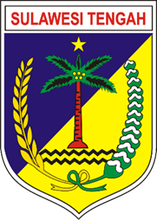

{.irbi-lambang fig-alt="Lambang Sulawesi Tengah" width=0.8in}



## Profil Wilayah

Provinsi Sulawesi Tengah beribukota di Kota Palu memiliki luas wilayah 61.605,71 km². Wilayah administrasi Provinsi Sulawesi Tengah terdiri dari 12 kabupaten dan 1 kota, dengan jumlah penduduk di tahun 2025 mencapai 3.156.100 jiwa (BPS Sulawesi Tengah, 2025).

Kondisi geologi pada Provinsi Sulawesi Tengah terletak diantara tiga lempeng tektonik yaitu Eurasia, India- Australia, dan Pasifik-Filipina. Provinsi Sulawesi Tengah didominasi oleh bentangan pegunungan dan dataran tinggi yang dipengaruhi oleh aktivitas tektonik sehingga terjadi pengangkatan dan penurunan pengaruhi oleh struktur geologi berupa sesar dan lipatan yang membentuk pegunungan yang membentang dari Kabupaten Buol dan Totoli. Topografi wilayah yang bervariasi membuat Sulawesi Tengah terkenal dengan wilayah yang memiliki pola hujan tipe anti–monsunal. Kondisi klimatologi pada provinsi Sulawesi Tengah memiliki curah hujan tahunan pada tahun 2024 sebesar 810 mm/tahun dengan jumlah hari hujan sebanyak 297 hari dan tingkat penyinaran matahari sebesar 4,88 jam.

Berdasarkan Data dan Informasi Bencana Indonesia (DIBI) tahun 2025, bencana yang paling banyak terjadi di Provinsi Sulawesi Tengah adalah bencana banjir dan cuaca ekstrem. Pengukuran Indeks Risiko Bencana Indonesia (IRBI) tahun 2025 pada Provinsi Sulawesi Tengah memiliki kelas risiko tinggi dengan nilai 195,78.



::: {.callout-note appearance="simple" icon=false}
## Ancaman Bencana

Banjir, Banjir Bandang, Cuaca Ekstrem, Gelombang Ekstrem dan Abrasi, Gempabumi, Kekeringan, Kebakaran Hutan dan Lahan, Tanah Longsor, Likuefaksi, Letusan Gunung Api, Tsunami.
:::

## Peta Indeks Risiko Bencana



## Tabel Nilai Indeks Risiko


