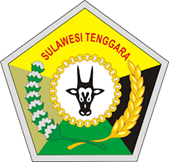

{.irbi-lambang fig-alt="Lambang Sulawesi Tenggara" width=0.8in}



## Profil Wilayah

Provinsi Sulawesi Tenggara beribukota di Kota Kendari memiliki luas wilayah 36.159,71 km². Wilayah administrasi Provinsi Sulawesi Tenggara terdiri dari 15 kabupaten dan 2 kota, dengan jumlah penduduk di tahun 2025 mencapai 2.836.740 jiwa (BPS Sulawesi Tenggara, 2025).

Kondisi geologi pada Provinsi Sulawesi Tenggara dipengaruhi oleh tumbukan antara lempeng Australia dan lempeng Pasifik dan sesar geser mengiri yang membentuk pegunungan Tangkelamboke, pegunungan Mengkoka, dan Pegunungan Matarombeo pada bagian tengah, pegunungan Rumbia dan Mendoke pada bagian selatan, Kompeks Danau Malili pada bagian Utara yang terbentuk dari sesar Matano (Surono, 2013). Topografi pada provinsi Sulawesi Tenggara didominasi pegunungan, bergelombang, dan berbukit. Sulawesi Tenggara memiliki dua musim, yaitu musim kemarau dan penghujan. Pada tahun 2024, pantauan di Stasiun Klimatologi Sulawesi Tenggara oleh BMKG, rata-rata curah hujan adalah 2.165,30 mm, dengan puncak curah hujan tertinggi pada bulan Mei. Sementara jumlah hari hujan terpantau sebanyak 315 hari dalam satu tahun. (BPS Sulawesi Tenggara, 2025).

Berdasarkan Data dan Informasi Bencana Indonesia (DIBI) tahun 2025, bencana yang paling banyak terjadi di Provinsi Sulawesi Tenggara adalah bencana banjir dan gempa bumi. Pengukuran Indeks Risiko Bencana Indonesia (IRBI) tahun 2025 pada Provinsi Sulawesi Tenggara memiliki kelas risiko tinggi dengan nilai 178,90.



::: {.callout-note appearance="simple" icon=false}
## Ancaman Bencana

Banjir, Banjir Bandang, Cuaca Ekstrem, Gelombang Ekstrem dan Abrasi, Gempabumi, Kebakaran Hutan dan Lahan, Kekeringan, Tanah Longsor, Tsunami, Likuefaksi.
:::

## Peta Indeks Risiko Bencana



## Tabel Nilai Indeks Risiko


