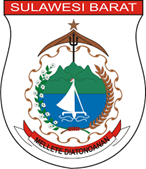

{.irbi-lambang fig-alt="Lambang Sulawesi Barat" width=0.8in}



## Profil Wilayah

Provinsi Sulawesi Barat beribukota di Mamuju memiliki luas wilayah 16.594,75km². Wilayah administrasi Provinsi Sulawesi Barat terdiri dari 6 kabupaten, dengan jumlah penduduk di tahun 2025 mencapai 1.525.335 juta jiwa (BPS Sulawesi Barat, 2025).

Kondisi geologi pada Provinsi Sulawesi Barat dipengaruhi oleh struktur geologi berupa sesar Palu Kuro yang merupakan sesar utama yang membentuk Cekungan Palu. Topografi pada provinsi Sulawesi Barat bervariasi, wilayah dengan topografi datar dapat ditemui di Kabupaten Polewali Mandar dan Pasangkayu, sedangkan untuk topografi berbukit dan pegunungan dapat ditemukan di wilayah Mamuju, Majene, dan Mamasa. Kondisi klimatologi pada provinsi Sulawesi Barat memiliki curah hujan tahunan pada tahun 2024 sebesar 1.556,40 mm/tahun dengan jumlah hari hujan sebanyak 268 hari dan tingkat penyinaran matahari sebesar 6,22 jam. Rata-rata suhu sebesar 28,3°C dan rata-rata kelembaban 80,22%.

Berdasarkan Data dan Informasi Bencana Indonesia (DIBI) tahun 2025, bencana yang paling banyak terjadi di Provinsi Sulawesi Barat adalah bencana banjir. Pengukuran Indeks Risiko Bencana Indonesia (IRBI) tahun 2025 pada Provinsi Sulawesi Barat memiliki kelas risiko Tinggi dengan nilai 211,46.



::: {.callout-note appearance="simple" icon=false}
## Ancaman Bencana

Banjir, Banjir Bandang, Cuaca Ekstrem, Gelombang Ekstrem dan Abrasi, Gempa Bumi, Kekeringan, Kebakaran Hutan Dan Lahan, Tanah Longsor, Likuefaksi, Tsunami.
:::

## Peta Indeks Risiko Bencana



## Tabel Nilai Indeks Risiko


