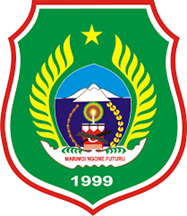

{.irbi-lambang fig-alt="Lambang Maluku Utara" width=0.8in}



## Profil Wilayah

Provinsi Maluku Utara beribukota di Sofifi memiliki luas wilayah 32.998,696 km². Wilayah administrasi Provinsi Maluku Utara terdiri dari 8 kabupaten dan 2 kota, dengan jumlah penduduk di tahun 2025 mencapai 1.373.820 jiwa (BPS Maluku Utara, 2025).

Kondisi geologi pada Provinsi Maluku Utara dipengaruhi oleh tiga lempeng besar yaitu Lempeng Eurasia, Lempeng Pasifik, dan lempeng Indo-Australia yang bertemu di wilayah Halmahera. Di bagian utara dari arah Maluku Utara terdapat beberapa lempeng mikro yang mempengaruhi seismisitas di kawasan ini yaitu busur kepulauan Halmahera, Sangihe dan lempeng mikro di laut Maluku. Topografi pada Provinsi Maluku Utara didominasi wilayah pegunungan dan perbukitan, serta pulau-pulau kecil dengan pesisir pantai. Rata-rata suhu di Maluku Utara adalah 27,68 sepanjang tahun 2024. Sedangkan jumlah hari hujan tercatat sebanyak 195,42 hari selama tahun 2024.

Berdasarkan Data dan Informasi Bencana Indonesia (DIBI) tahun 2025, bencana yang paling banyak terjadi di Provinsi Maluku Utara adalah bencana banjir. Pengukuran Indeks Risiko Bencana Indonesia (IRBI) tahun 2025 pada Provinsi Maluku Utara memiliki kelas risiko Tinggi dengan nilai 220,03.



::: {.callout-note appearance="simple" icon=false}
## Ancaman Bencana

Banjir, Banjir Bandang, Cuaca Ekstrem, Gelombang Ekstremdan Abrasi, Gempabumi, Kebakaran Hutan dan Lahan, Kekeringan, Tanah Longsor, Tsunami, Letusan Gunung Api, dan Likuefaksi.
:::

## Peta Indeks Risiko Bencana



## Tabel Nilai Indeks Risiko


