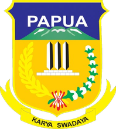

{.irbi-lambang fig-alt="Lambang Papua" width=0.8in}



## Profil Wilayah

Provinsi Papua beribukota di Kota Jayapura, dengan luas wilayah 82.680,95 km². Wilayah administrasi Provinsi Papua terdiri dari 8 kabupaten dan 1 kota, dengan jumlah penduduk di tahun 2025 sebanyak 1 juta jiwa. (BPS, 2025)

Wilayah Provinsi Papua terdiri dari wilayah dataran rendah, pesisir, dan pegunungan yang terdiri atas tiga deretan pegunungan yaitu: Pegunungan Utara di lingkar luar, deretan Pegunungan Selatan di lingkar dalam, serta deretan Pegunungan Tengah yang merupakan tepi dari The Australian Continent. Daerah pegunungan berada pada ketinggian diantara 3.000-4.000 dan lebih dari 4.000 meter dari permukaan laut (mdpl). Kondisi geologi pada Provinsi Papua dipengaruhi oleh aktivitas tektonik yang kompleks membentuk beberapa zona sesar aktif termasuk zona sesar Yapen, zona sesar Sorong, dan Zona sesar Misool - Onin. Kondisi klimatologi pada provinsi Papua termasuk dalam iklim hutan hujan tropis (tropical rain forest).

Berdasarkan Data dan Informasi Bencana Indonesia (DIBI) tahun 2025, bencana yang terjadi adalah banjir dan gempabumi. Pengukuran Indeks Risiko Bencana Indonesia (IRBI) 2025 Provinsi Papua memiliki kelas risiko Tinggi dengan nilai 218,51.



::: {.callout-note appearance="simple" icon=false}
## Ancaman Bencana

Banjir, Banjir Bandang, Cuaca Ekstrem, Gelombang Ekstrem dan Abrasi, Gempabumi, Likuefaksi, Kebakaran Hutan dan Lahan, Kekeringan, Tanah Longsor, Tsunami.
:::

## Peta Indeks Risiko Bencana



## Tabel Nilai Indeks Risiko


