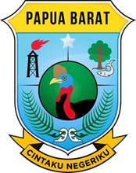

{.irbi-lambang fig-alt="Lambang Papua Barat" width=0.8in}



## Profil Wilayah

Provinsi Papua Barat beribukota di Manokwari, dengan luas wilayah 60.275,33 km². Wilayah administrasi Provinsi Papua Barat terdiri dari 7 kabupaten, dengan jumlah penduduk di tahun 2025 sebanyak 587 ribu jiwa. (BPS, 2025)

Kondisi topografi Provinsi Papua Barat sangat bervariasi, dari wilayah dataran rendah hingga pegunungan. Sebagian besar wilayah Provinsi Papua Barat termasuk dalam wilayah perbukitan (kelas ketinggian 100-1.000 m) dengan luas mencapai 47.741 km² (49,21%). Kondisi geologi pada Provinsi Papua Barat dipengaruhi oleh interaksi lempeng tektonik yaitu Lempeng Australia dan Lempeng Pasifik dan menghasilkan kondisi geologi yang kompleks seperti Sesar Sorong (SFZ), Sesar Ransiki (RFZ), Sesar Lungguru (LFZ) dan Sesar Tarera-Aiduna (TAFZ). Kondisi klimatologi di Provinsi Papua Barat secara umum memiliki iklim tropis dengan jumlah curah hujan pada tahun 2024 sebesar 2.454,3 mm. (BPS, 2025)

Berdasarkan Data dan Informasi Bencana Indonesia (DIBI) tahun 2025, bencana yang terjadi adalah banjir, banjir yang terjadi paling parah adalah di Kabupaten Fakfak dengan bangunan terdampak 4 rumah rusak, 100 rumah terendam dan 2 fasum rusak. Pengukuran Indeks Risiko Bencana Indonesia (IRBI) 2025 Provinsi Papua Barat memiliki kelas risiko Tinggi dengan nilai 218,05.



::: {.callout-note appearance="simple" icon=false}
## Ancaman Bencana

Banjir, Banjir Bandang, Cuaca Ekstrem, Gelombang Ekstrem dan Abrasi, Gempabumi, Kekeringan, Kebakaran Hutan dan Lahan, Tanah Longsor, Likuefaksi, dan Tsunami.
:::

## Peta Indeks Risiko Bencana



## Tabel Nilai Indeks Risiko


