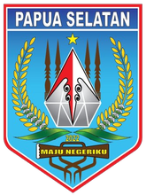

{.irbi-lambang fig-alt="Lambang Papua Selatan" width=0.8in}



## Profil Wilayah

Provinsi Papua Selatan beribukota di Kabupaten Merauke, dengan luas wilayah 11.849,16 km². Wilayah administrasi Provinsi Papua Selatan terdiri dari 4 kabupaten, dengan jumlah penduduk di tahun 2025 sebanyak 549 ribu jiwa. (BPS, 2025)

Kondisi topografi Provinsi Papua Selatan didominasi oleh dataran rendah dengan ketinggian rata-ratanya sebesar 0- 55 mdpl. Secara geologis Provinsi Papua Selatan secara umum memiliki geologi yang dipengaruhi oleh tatanan tektonik yang berkaitan dengan lempeng Australia dan bagian dari dangkalan Sahul. Adapun struktur geologi yang berkembang di Papua Selatan adalah sesar naik dan sesar geser (RPJMD Provinsi Papua Selatan, 2025).

Kondisi klimatologi di Provinsi Papua Selatan secara umum memiliki iklim tropis dengan curah hujan tahunan pada tahun 2024 sebesar 190,25 mm/tahun.

Berdasarkan Data dan Informasi Bencana Indonesia (DIBI) tahun 2025, bencana yang terjadi adalah banjir dengan jumlah rumah yang terendam sebanyak 348 rumah. Pengukuran Indeks Risiko Bencana Indonesia (IRBI) 2025 Provinsi Papua Selatan memiliki kelas risiko Sedang dengan nilai 165,40.



::: {.callout-note appearance="simple" icon=false}
## Ancaman Bencana

Banjir, Cuaca Ekstrem, Gelombang Ekstrem dan Abrasi, Gempabumi, Kebakaran Hutan dan Lahan, Kekeringan, Tanah Longsor, Tsunami.
:::

## Peta Indeks Risiko Bencana



## Tabel Nilai Indeks Risiko


