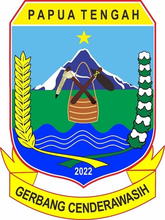

{.irbi-lambang fig-alt="Lambang Papua Tengah" width=0.8in}



## Profil Wilayah

Provinsi Papua Tengah beribukota di Kabupaten Nabire, dengan luas wilayah 61.072,91 km². Wilayah administrasi Provinsi Papua Tengah terdiri dari 4 kabupaten, dengan jumlah penduduk di tahun 2025 sebanyak 1,49 juta jiwa. (BPS, 2025)

Kondisi geologi pada Provinsi Papua Tengah dipengaruhi oleh struktur geologi berupa sesar dan lipatan yang membentuk dominasi Pegunungan Struktural Jalur Jayawijaya membentang dari barat ke timur, diikuti dengan dataran fluvial, gambut, dan pantai lalu dengan luas paling kecil yaitu perbukitan struktural. Topografi pada Provinsi Papua Tengah didominasi wilayah datar. Kondisi klimatologi pada provinsi Papua Tengah secara umum termasuk daerah beriklim tropis dan lembab serta memiliki rata-rata curah hujan tahunan sebesar 2.500 - 4.000 mm/tahun. (RPIW Provinsi Papua Tengah 2025- 2034).

Berdasarkan Data dan Informasi Bencana Indonesia (DIBI) tahun 2025, bencana yang terjadi adalah tanah longsor. Pengukuran Indeks Risiko Bencana Indonesia (IRBI) 2025 Provinsi Papua Tengah memiliki kelas risiko Tinggi dengan nilai 193,46.



::: {.callout-note appearance="simple" icon=false}
## Ancaman Bencana

Banjir, Banjir Bandang, Cuaca Ekstrem, Gelombang Ekstrem dan Abrasi, Gempabumi, Likuefaksi, Kebakaran Hutan dan Lahan, Kekeringan, Tanah Longsor, Tsunami.
:::

## Peta Indeks Risiko Bencana



## Tabel Nilai Indeks Risiko


