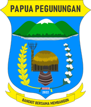

{.irbi-lambang fig-alt="Lambang Papua Pegunungan" width=0.8in}



## Profil Wilayah

Provinsi Papua Pegunungan beribukota di Kabupaten Jayawijaya, dengan luas wilayah 51.213,33 km². Wilayah administrasi Provinsi Papua Pegunungan terdiri dari 8 kabupaten, dengan jumlah penduduk di tahun 2025 sebanyak 1,48 juta jiwa. (BPS, 2025)

Kondisi Topografi di Provinsi Papua Pegunungan didominasi oleh barisan pegunungan tinggi. Secara geologis Provinsi Papua Pegunungan berada di zona tumbukan lempeng yang sangat aktif. Kondisi klimatologi di Provinsi Papua Pegunungan secara umum memiliki iklim tropis dengan curah hujan tahunan pada tahun 2024 sebesar 1680 mm/tahun.

Berdasarkan Data dan Informasi Bencana Indonesia (DIBI) tahun 2025, bencana yang paling banyak terjadi adalah banjir dan tanah longsor. Pengukuran Indeks Risiko Bencana Indonesia (IRBI) 2025 Provinsi Papua Pegunungan memiliki kelas risiko Tinggi dengan nilai 193,09.



::: {.callout-note appearance="simple" icon=false}
## Ancaman Bencana

Banjir, Banjir Bandang, Cuaca Ekstrem, Gempabumi, Likuefaksi, Kebakaran Hutan dan Lahan, Kekeringan, Tanah Longsor.
:::

## Peta Indeks Risiko Bencana



## Tabel Nilai Indeks Risiko


