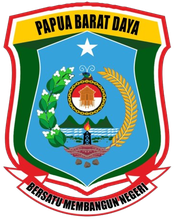

{.irbi-lambang fig-alt="Lambang Papua Barat Daya" width=0.8in}



## Profil Wilayah

Provinsi Papua Barat Daya beribukota di Kota Sorong, dengan luas wilayah 39.122,95 km². Wilayah administrasi Provinsi Papua Barat Daya terdiri dari 5 kabupaten dan 1 kota, dengan jumlah penduduk di tahun 2025 sebanyak 636 ribu jiwa. (BPS, 2025)

Topografi pada provinsi Papua Barat Daya didominasi oleh perbukitan dengan kelas ketinggian 100 - 1.000m, kemudian diikuti dataran rendah (ketinggian 0 - 100 m) dan pegunungan (>1.000m). Kondisi geologi pada Papua Barat Daya dipengaruhi oleh interaksi lempeng tektonik yaitu Lempeng Australia dan Lempeng Pasifik dan menghasilkan kondisi geologi yang kompleks seperti Sesar Sorong (SFZ), Sesar Ransiki (RFZ), Sesar Lungguru (LFZ) dan Sesar Tarera-Aiduna (TAFZ). Kondisi klimatologi pada Provinsi Papua Barat Daya memiliki Jumlah curah hujan per tahun sebesar 4.542,10 mm (BPS Provinsi Papua Barat Daya, 2025)

Berdasarkan Data dan Informasi Bencana Indonesia (DIBI) tahun 2025, bencana yang paling banyak terjadi adalah banjir dan tanah longsor. Pengukuran Indeks Risiko Bencana Indonesia (IRBI) 2025 Provinsi Papua Barat Daya memiliki kelas risiko Tinggi dengan nilai 230,78.



::: {.callout-note appearance="simple" icon=false}
## Ancaman Bencana

Banjir, Banjir Bandang, Cuaca Ekstrem, Gelombang Ekstrem dan Abrasi, Gempabumi, Kebakaran Hutan dan Lahan, Kekeringan, Tanah Longsor, Tsunami dan Likuefaksi.
:::

## Peta Indeks Risiko Bencana



## Tabel Nilai Indeks Risiko


