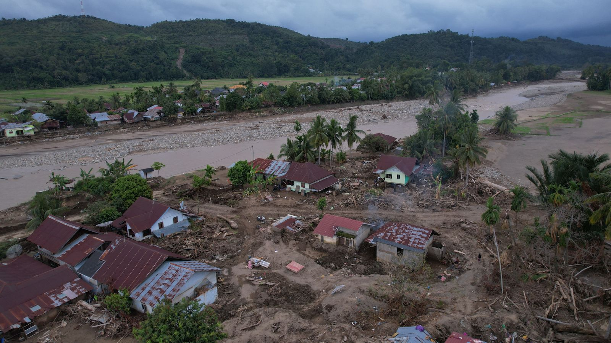

{.irbi-foto-bab fig-alt="Foto dokumentasi kebencanaan"}

Tahun 2025 menegaskan bahwa risiko bencana tetap menjadi tantangan struktural pembangunan nasional. World Risk Report secara konsisten menempatkan Indonesia pada kelompok negara dengan tingkat risiko tinggi akibat kombinasi paparan bahaya alam yang besar, kerentanan sosial-ekonomi, serta kapasitas yang masih perlu diperkuat. Sejalan dengan itu, dinamika kejadian bencana nasional sepanjang tahun 2025 masih didominasi oleh bencana hidrometeorologi seperti banjir, tanah longsor, dan cuaca ekstrem, yang berdampak pada korban jiwa, kerusakan infrastruktur, serta gangguan aktivitas ekonomi dan pelayanan publik. Ancaman geologi seperti gempa bumi dan aktivitas vulkanik tetap menjadi risiko laten dengan potensi dampak besar. Kondisi ini menunjukkan bahwa pengurangan risiko bencana harus terintegrasi secara sistematis dalam agenda pembangunan nasional.

Berdasarkan hasil penghitungan Tahun 2025, rata-rata IRBI nasional tercatat sebesar 147,95. Nilai ini merepresentasikan kondisi risiko aktual nasional dan disusun dari komponen bahaya berbasis data tahun 2021, komponen kerentanan berdasarkan hasil proyeksi, serta komponen kapasitas yang menggunakan nilai aktual Indeks Ketahanan Daerah (IKD) Tahun 2025. Angka tersebut menjadi rujukan utama dalam membaca kondisi risiko terkini dan menetapkan prioritas intervensi kebijakan pada tahun berjalan.

Dalam kerangka perencanaan jangka menengah nasional, ditetapkan nilai IRBI nasional sebesar 141,17 sebagai baseline target Tahun 2025, sebagaimana tercantum dalam Dokumen Rencana Pembangunan Jangka Menengah Nasional (RPJMN) 2025–2029.

Nilai ini berasal dari hasil proyeksi IRBI 2025–2045 yang disusun pada tahun 2024, menggunakan komponen bahaya tahun 2021, komponen kerentanan hasil proyeksi jangka panjang, serta komponen kapasitas berupa proyeksi dataset 2018–2023.

Dengan demikian, angka 141,17 berfungsi sebagai baseline perencanaan makro jangka menengah, sedangkan nilai 147,95 mencerminkan pembaruan kondisi aktual berdasarkan kapasitas riil Tahun 2025. Perbedaan antara kedua angka tersebut mencerminkan perbedaan pendekatan proyektif dan aktual dalam pengukuran, serta dinamika pembaruan data, dan tidak menunjukkan perubahan metodologi maupun deviasi terhadap arah kebijakan RPJMN.

Untuk menjaga konsistensi pemantauan tahunan, tren IRBI 2024–2025 dihitung menggunakan komponen bahaya dan kerentanan berbasis baseline data tahun 2021, dengan pembaruan komponen kapasitas berdasarkan IKD masing-masing tahun. Dengan pendekatan komparatif tersebut, nilai IRBI nasional menurun dari 171,95 pada Tahun 2024 menjadi 170,17 pada Tahun 2025, atau terjadi penurunan sebesar 1,03%. Capaian ini menunjukkan adanya peningkatan kapasitas daerah yang berkontribusi terhadap pengurangan risiko secara bertahap, meskipun tingkat risiko nasional secara keseluruhan masih memerlukan penguatan kebijakan yang berkelanjutan untuk mencapai target RPJMN.

Dari sisi kapasitas, partisipasi penilaian IKD meningkat dari 445 kabupaten/kota pada Tahun 2024 menjadi 469 kabupaten/kota pada Tahun 2025, mencerminkan semakin meningkatnya komitmen daerah dalam memperkuat tata kelola penanggulangan bencana.

Pada tingkat provinsi, distribusi kapasitas menunjukkan bahwa 50% provinsi berada pada kelas kapasitas sedang dan 50% pada kelas kapasitas rendah, yang menegaskan perlunya akselerasi penguatan kelembagaan dan kebijakan di tingkat regional. Pada tingkat kabupaten/kota, 56,42% berada pada kelas kapasitas sedang–tinggi, sementara 43,58% masih berada pada kelas kapasitas rendah. Komposisi ini menunjukkan bahwa meskipun terdapat kemajuan, penguatan kapasitas tetap menjadi faktor penentu dalam menurunkan risiko secara lebih signifikan dalam periode 2025–2029.

Variasi tingkat risiko antar-wilayah masih cukup signifikan, dipengaruhi oleh kombinasi karakteristik bahaya, kondisi kerentanan sosial-ekonomi, serta kapasitas kelembagaan daerah. Oleh karena itu, strategi penurunan risiko perlu dilakukan secara diferensiatif dan berbasis karakteristik wilayah, dengan penajaman prioritas pada daerah dengan kapasitas rendah dan tingkat eksposur tinggi.

Dengan IRBI 2025 sebagai instrumen pemantauan tahunan dan baseline target RPJMN, pemerintah memiliki pijakan kuantitatif yang jelas untuk mengawal penurunan risiko hingga Tahun 2029. Penurunan sebesar 1,03% pada tahun pertama periode ini merupakan sinyal awal yang positif, namun belum cukup untuk memastikan tercapainya target jangka menengah tanpa penguatan kebijakan yang konsisten dan terukur. Integrasi pengurangan risiko bencana ke dalam perencanaan pembangunan, peningkatan kapasitas daerah secara sistematis, serta sinergi lintas sektor dan lintas tingkat pemerintahan menjadi determinan utama dalam mewujudkan resiliensi berkelanjutan, sehingga pembangunan nasional tidak hanya mampu mengurangi risiko secara bertahap, tetapi juga mempertahankan ketangguhan dalam menghadapi dinamika ancaman di masa depan.

::: {.irbi-kutipan}
Penurunan risiko sebesar 1,03% pada tahun 2025 adalah sinyal awal ketangguhan, sebuah langkah nyata menuju Indonesia yang lebih resilien.
:::
